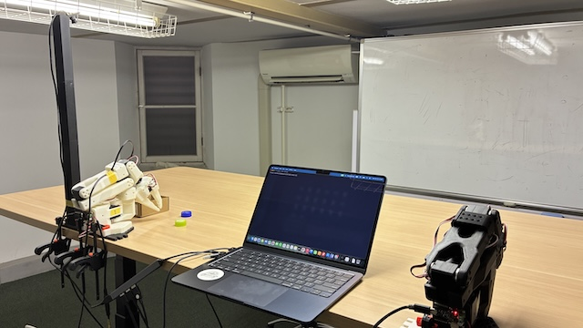
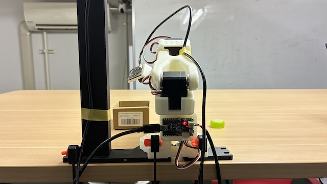
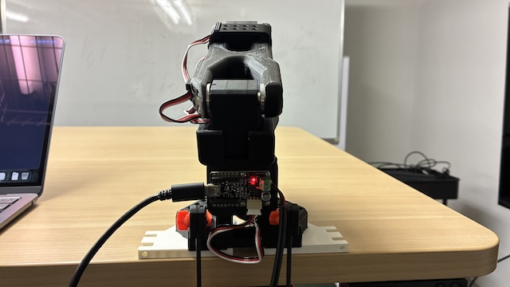
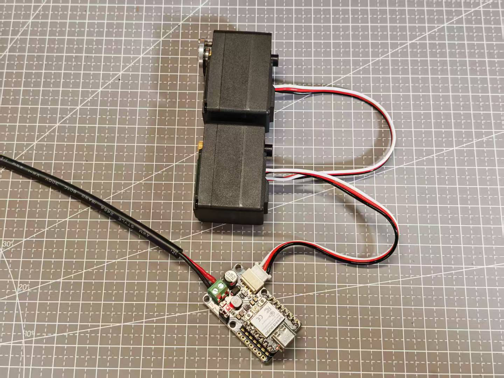
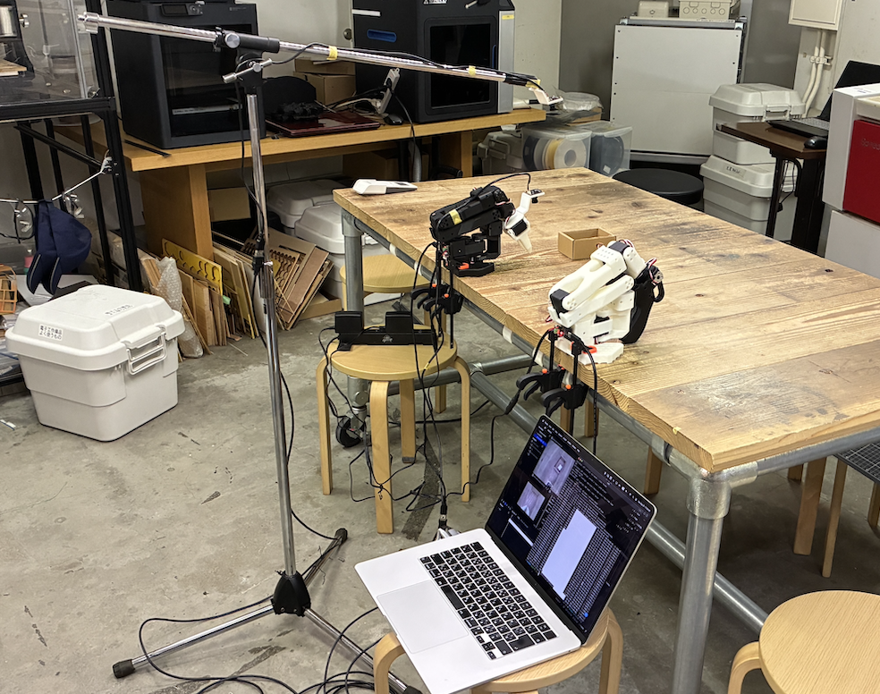

# 2. SO-101 のセットアップ

## 概要

リーダーアーム（手で動かす側）でフォロワーアーム（追従する側）を操作できる状態にする。所要時間は約 60 分。

## 準備物

- [1. LeRobot のインストール](./01_install.md) を終えた PC
- 組み立て済みの SO-101 リーダー・フォロワー各 1 台（組み立て方は補足資料 [11. 組み立て](./11_assemble.md)）
- USB ケーブル 2 本、フォロワー用電源
- USB カメラ 2 台（`front`: 正面用、`wrist`: 手元用）

> **安全のために**
> - 配線を抜き差しするときは、必ず電源を切る。
> - フォロワーの周りに物や手を置かない。
> - おかしな動きをしたら、すぐに `Ctrl + C` で止める。

## 机の配置例

アームとカメラを机に固定する。配置は自由に変えてよいが、収録を始めたら動かさない。



| フォロワー | リーダー |
| --- | --- |
|  |  |

## この資料で使う値

| 項目 | 値 | 説明 |
| --- | --- | --- |
| フォロワーの ID | `my_follower` | キャリブレーション結果の保存名。以降の資料でも同じ名前を使う |
| リーダーの ID | `my_leader` | 同上 |
| `<FOLLOWER_PORT>` | 手順 2 で調べる | フォロワーの USB ポート名 |
| `<LEADER_PORT>` | 手順 2 で調べる | リーダーの USB ポート名 |

`<...>` の部分は、自分の値に置き換えて実行する（`<` `>` は消す）。

## 手順 1: 環境を有効にする

```bash
conda activate lerobot
```

## 手順 2: USB ポートを調べる

1. リーダーとフォロワーを USB で PC につなぐ。フォロワーは電源もつなぐ。
2. 次を実行する。

   ```bash
   lerobot-find-port
   ```

3. `Remove the USB cable...` と出たら、**フォロワーの USB だけ** を抜いて `Enter` を押す。
4. 表示された `The port of this MotorsBus is ...` がフォロワーのポートである。メモ帳に書き留め、USB を差し直す。
5. もう一度 2〜4 を行い、今度はリーダーの USB を抜いてリーダーのポートを調べる。

メモの例:

```text
macOS                                  Windows
フォロワー: /dev/tty.usbmodem5A7A0185911   フォロワー: COM3
リーダー:   /dev/tty.usbmodem5A7A0574321   リーダー:   COM4
```

> USB を差す場所を変えるとポート名が変わることがある。その場合は調べ直す。

## 手順 3: モーターを設定する（新品のときだけ）

> **すでに設定済みのアームでは、この手順を飛ばして手順 4 へ進む。**
> 新品のモーターを使うとき、またはモーターを交換したときだけ行う。

各モーターに番号（ID）を書き込む。**ボードにはモーターを 1 個ずつつなぐ**。

### フォロワー

```bash
lerobot-setup-motors \
  --robot.type=so101_follower \
  --robot.port=<FOLLOWER_PORT>
```

画面の指示に従って進める。

1. `Connect the controller board to the 'gripper' motor only` と出たら、グリッパーのモーター **だけ** をボードにつなぎ、`Enter` を押す。
2. `'gripper' motor id set to 6` と出たら成功。
3. 次のモーター名が表示されるので、そのモーターだけをつなぎ替えて `Enter` を押す。6 個すべて繰り返す。
4. 終わったら、モーター同士をケーブルで数珠つなぎにし、肩のモーター（ID 1）をボードにつなぐ。

   

手順は公式動画で確認できる: [モーター設定の動画](https://huggingface.co/datasets/huggingface/documentation-images/resolve/main/lerobot/setup_motors_so101_2.mp4)

### リーダー

同じ流れで行う。

```bash
lerobot-setup-motors \
  --teleop.type=so101_leader \
  --teleop.port=<LEADER_PORT>
```

> エラーが出たら: 電源、USB ケーブル、モーターの 3 ピンケーブルが抜けていないか確認する。

## 手順 4: キャリブレーションする

リーダーとフォロワーが同じ姿勢で同じ値になるよう、各関節の範囲を登録する。**両方のアームで行う。**

### フォロワー

```bash
lerobot-calibrate \
  --robot.type=so101_follower \
  --robot.port=<FOLLOWER_PORT> \
  --robot.id=my_follower
```

1. アームを手で動かし、すべての関節を **可動範囲の真ん中** に合わせて `Enter` を押す。
2. 各関節を **端から端まで** ゆっくり動かす。グリッパーも全開・全閉にする。
3. 全関節を動かしたら `Enter` を押して終了する。

> 2 回目以降は `Press ENTER to use provided calibration file ...` と聞かれる。やり直すときは `c` を入力して `Enter`。

動きは公式動画で確認できる: [キャリブレーションの動画](https://huggingface.co/datasets/huggingface/documentation-images/resolve/main/lerobot/calibrate_so101_2.mp4)

### リーダー

同じ流れで行う。

```bash
lerobot-calibrate \
  --teleop.type=so101_leader \
  --teleop.port=<LEADER_PORT> \
  --teleop.id=my_leader
```

## 手順 5: テレオペレーションで動かす

リーダーを動かすとフォロワーが追従するか確認する。フォロワーの周りに何もないことを確認してから実行する。

```bash
lerobot-teleoperate \
  --robot.type=so101_follower \
  --robot.port=<FOLLOWER_PORT> \
  --robot.id=my_follower \
  --teleop.type=so101_leader \
  --teleop.port=<LEADER_PORT> \
  --teleop.id=my_leader
```

**確認**: リーダーをゆっくり動かし、フォロワーが同じように動けば OK。終了は `Ctrl + C`。

> 動かない・姿勢が大きくずれる場合: ポート名と ID を確認し、手順 4 のキャリブレーションをやり直す。

## 手順 6: カメラを追加する

### カメラ番号を調べる

```bash
lerobot-find-cameras opencv
```

見つかったカメラの番号（`0`、`1` など）をメモする。どちらが正面・手元か分からなければ、表示される画像を見て判断する。

### カメラ付きで動かす

`index_or_path` の `0` と `1` を、調べた番号に置き換える。

```bash
lerobot-teleoperate \
  --robot.type=so101_follower \
  --robot.port=<FOLLOWER_PORT> \
  --robot.id=my_follower \
  --robot.cameras="{front: {type: opencv, index_or_path: 0, width: 640, height: 480, fps: 30}, wrist: {type: opencv, index_or_path: 1, width: 640, height: 480, fps: 30}}" \
  --teleop.type=so101_leader \
  --teleop.port=<LEADER_PORT> \
  --teleop.id=my_leader \
  --display_data=true
```

**確認**: 映像ウィンドウが開き、次が見えれば OK。

- `front`: 作業台全体と対象物
- `wrist`: グリッパーと対象物

カメラの位置・向き・照明はここで決めて **固定する**。データ収録後に動かすと、学習したモデルがうまく動かなくなる。

カメラ配置の例（スタンドで上から作業台全体を撮る）:



> 映像が出ない場合: Zoom などカメラを使うアプリを閉じる。OS の設定でターミナル（Miniforge Prompt）にカメラの使用を許可する。

## 記録しておく値

次の資料でも使うので、メモ帳に残しておく。

```text
フォロワー: port=<FOLLOWER_PORT>  id=my_follower
リーダー:   port=<LEADER_PORT>    id=my_leader
カメラ:     front=0  wrist=1  (640x480, 30fps)
```

## 次へ

[3. データセットの収録](./03_dataset.md)

## 参考

- [LeRobot 公式: SO-101](https://huggingface.co/docs/lerobot/v0.6.1/so101)
- [LeRobot 公式: Imitation Learning on Real-World Robots](https://huggingface.co/docs/lerobot/v0.6.1/il_robots)
- [LeRobot 公式: Cameras](https://huggingface.co/docs/lerobot/v0.6.1/cameras)
