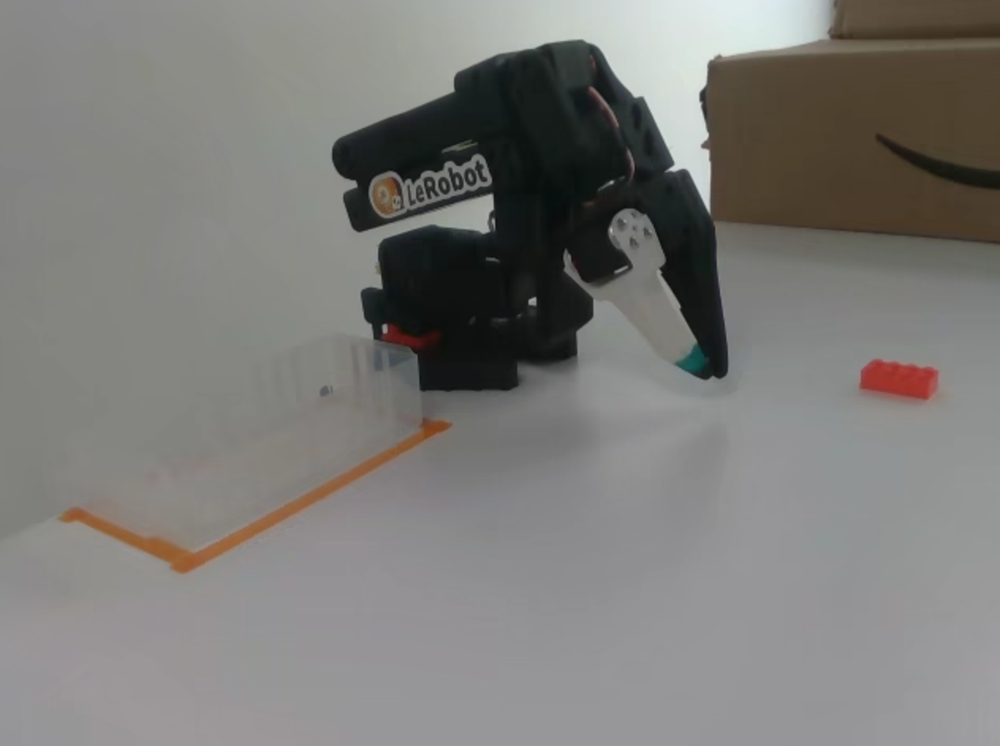
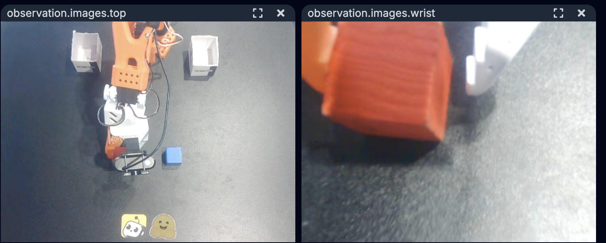

# 3. データセットの収録

## 概要

リーダーでお手本の動き（デモ）を操作し、学習用データとして Hugging Face Hub に保存する。所要時間は約 90 分。

## 準備物

- [2. SO-101 のセットアップ](./02_setup.md) でメモした値（ポート名、ID、カメラ番号）
- Hugging Face アカウント（手順 1 で作る）
- 対象物（例: 赤い立方体）と置き場所（例: 箱）

> **公開範囲に注意**
> データセットは **誰でも見られる公開設定** で Hub に保存される。人の顔、名札、画面、書類などがカメラに映らないようにする。

## この資料で使う値

| 項目 | 例 | 説明 |
| --- | --- | --- |
| `<HF_USER>` | `taro-yamada` | Hugging Face のユーザー名（手順 1 で確認） |
| データセット名 | `so101-pick-cube` | 小文字・数字・ハイフンで付ける。`eval_` で始めない |
| タスク説明 | `赤い立方体を箱に入れる` | 全エピソードで同じ文を使う |
| エピソード | 1 回分のデモ | 置く → つかむ → 運ぶ → 離す、までの 1 回 |

## 手順 1: Hugging Face にログインする

1. [Hugging Face](https://huggingface.co/join) でアカウントを作る。
2. [Access Tokens](https://huggingface.co/settings/tokens) で **Create new token** を押し、種類を **Write** にして作成する。
3. 表示されたトークン（`hf_` で始まる文字列）をコピーする。**一度しか表示されない。**
4. ターミナルで次を実行し、トークンを貼り付けて `Enter` を押す（入力しても画面には何も表示されない）。

   ```bash
   conda activate lerobot
   hf auth login
   ```

   追加の質問（git credential など）が出たら `n` でよい。

5. 確認する。

   ```bash
   hf auth whoami
   ```

   表示されたユーザー名が `<HF_USER>` である。

> トークンはパスワードと同じ。チャットやスクリーンショットに載せない。次の [4. ACT の学習と評価](./04_act.md) でも使う。

## 手順 2: タスクを決める

収録前に、次を決めて紙やメモに書いておく。

| 決めること | 例 |
| --- | --- |
| タスク | 赤い立方体を箱に入れる |
| 成功の条件 | 立方体が箱に入り、グリッパーが離れている |
| 立方体の置き場所 | テープで印を付けた 5 か所（左手前・左奥・中央・右手前・右奥） |
| 固定するもの | カメラ、箱、照明 |

タスクの例（ブロックをつかんで箱に入れる）:



**ポイント**: カメラ映像だけを見て、自分でもタスクができるかを確認する。見えないものはモデルにも分からない。

良い映像の例（左: 上から全体、右: 手元）。対象物・グリッパー・箱がはっきり映っている。



> この写真ではカメラ名が `top` になっている。この資料では `front` と `wrist` を使う。

## 手順 3: 試しに 3 回収録する

本番の前に、正しく保存できるかを 3 エピソードで確かめる。

```bash
lerobot-record \
  --robot.type=so101_follower \
  --robot.port=<FOLLOWER_PORT> \
  --robot.id=my_follower \
  --robot.cameras="{front: {type: opencv, index_or_path: 0, width: 640, height: 480, fps: 30}, wrist: {type: opencv, index_or_path: 1, width: 640, height: 480, fps: 30}}" \
  --teleop.type=so101_leader \
  --teleop.port=<LEADER_PORT> \
  --teleop.id=my_leader \
  --display_data=true \
  --dataset.repo_id=<HF_USER>/so101-pick-cube-test \
  --dataset.single_task="赤い立方体を箱に入れる" \
  --dataset.num_episodes=3 \
  --dataset.episode_time_s=30 \
  --dataset.reset_time_s=10 \
  --dataset.no_stamp=true
```

| 指定 | 意味 |
| --- | --- |
| `--dataset.repo_id` | 保存先（`ユーザー名/データセット名`） |
| `--dataset.num_episodes` | 収録する回数 |
| `--dataset.episode_time_s` | 1 回の最大秒数 |
| `--dataset.reset_time_s` | 次の回までの片付け時間（秒） |
| `--dataset.no_stamp=true` | 名前に日時を付け足さない |

### 収録の流れ

1. 収録が始まったら、リーダーを操作してタスクを行う。
2. 終わったら `→` キーで次へ進む（30 秒たつと自動で進む）。
3. 片付け時間（10 秒）の間に、立方体とアームを最初の位置へ戻す。
4. 3 回終わると、動画の変換と Hub へのアップロードが自動で始まる。**終わるまでターミナルを閉じない。**

### キー操作

| キー | 動作 |
| --- | --- |
| `→` または `n` | 今の回を終えて次へ進む |
| `←` または `r` | 今の回を捨てて撮り直す |
| `Esc` または `q` | 収録を終了して保存・アップロードする |

> macOS でキーが効かない場合: 収録中はターミナルをクリックして選択した状態にしておく。

## 手順 4: 保存したデータを確認する

1. [LeRobot Dataset Visualizer](https://huggingface.co/spaces/lerobot/visualize_dataset) を開く。
2. `<HF_USER>/so101-pick-cube-test` を入力して表示する。
3. 3 回分すべてについて、次を確認する。

- [ ] `front` と `wrist` の両方の映像が最後まで映っている
- [ ] 立方体・グリッパー・箱が見えている
- [ ] 白い画面、映像の乱れ、途中停止がない

問題があれば、カメラや照明を直して手順 3 をやり直す。やり直すときは、名前を `so101-pick-cube-test2` のように **変える**（同じ名前ではエラーになる）。

## 手順 5: 本番の 50 回を収録する

試しの収録に問題がなければ、名前を本番用に変えて 50 回収録する。

1. 記録せずに 5〜10 回練習し、動かし方を毎回そろえる。
2. 手順 3 のコマンドで、次の 2 か所だけ変えて実行する。

   ```text
   --dataset.repo_id=<HF_USER>/so101-pick-cube
   --dataset.num_episodes=50
   ```

3. 立方体の置き場所を 5 か所に分け、**各 10 回ずつ** 収録する。

| 置き場所 | 回数 |
| --- | ---: |
| 左手前 | 10 |
| 左奥 | 10 |
| 中央 | 10 |
| 右手前 | 10 |
| 右奥 | 10 |

### 良いデータにするコツ

- 動きの順番（近づく → つかむ → 持ち上げる → 運ぶ → 離す）を毎回そろえる。
- 失敗したり、もたついたりした回は `←` で撮り直す。**成功したデモだけを残す。**
- 終わったらすぐ `→` を押し、止まっているだけの時間を入れない。
- カメラ、照明、箱の位置は途中で変えない。

収録後は、手順 4 と同じ方法で 50 回分を確認する。

## 途中で中断した・あとから追加したい場合

同じデータセットに続けて収録できる。手順 5 のコマンドに次の 2 行を足し、`--dataset.num_episodes` を **追加する回数** にする（合計数ではない）。

macOS:

```text
--resume=true
--dataset.root=$HOME/.cache/huggingface/lerobot/<HF_USER>/so101-pick-cube
```

Windows:

```text
--resume=true
--dataset.root=%USERPROFILE%\.cache\huggingface\lerobot\<HF_USER>\so101-pick-cube
```

カメラ・ID・タスク説明は、最初の収録と同じ値を使う。

## うまくいかないとき

| 症状 | 対処 |
| --- | --- |
| アップロードで `401` / `403` が出る | `hf auth whoami` を確認し、**Write** 権限のトークンで `hf auth login` をやり直す |
| `already exists` と出て始まらない | 同じ名前のデータセットがある。新しく作るなら名前を変える。続きなら上の「追加したい場合」を使う |
| カメラが映らない | カメラを使う他のアプリを閉じ、`lerobot-find-cameras opencv` で番号を確認し直す |
| アップロードだけ失敗した | データは PC に残っている。ネット接続を確認し、次を実行する |

アップロードのやり直し（macOS の例）:

```bash
hf upload <HF_USER>/so101-pick-cube ~/.cache/huggingface/lerobot/<HF_USER>/so101-pick-cube --repo-type dataset
```

## 次へ

[4. ACT の学習と評価](./04_act.md)

## 参考

- [LeRobot 公式: Record a dataset](https://huggingface.co/docs/lerobot/v0.6.1/il_robots#record-a-dataset)
- [What makes a good dataset（公式ブログ）](https://huggingface.co/blog/lerobot-datasets#what-makes-a-good-dataset)
