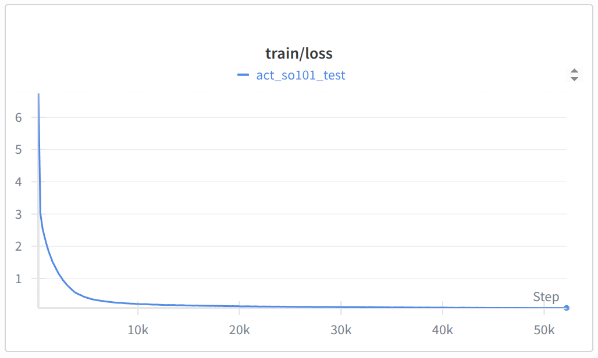

# 4. ACT の学習と評価

## 概要

収録したデータで ACT（模倣学習モデル）を Google Colab で学習し、SO-101 に自動でタスクをさせる。学習に数時間、評価に約 30 分かかる。

## 全体の流れ

```text
[Colab]  GPU を準備 → LeRobot を入れる → ログイン → 学習（進み具合は W&B で確認、モデルは Hub に自動保存）
[自分の PC]  Hub のモデルで SO-101 を動かす → 成功率を記録
```

## 準備物

- [3. データセットの収録](./03_dataset.md) で Hub に保存した本番データセット（`<HF_USER>/so101-pick-cube`）
- [3. データセットの収録](./03_dataset.md) の手順 1 で作った Hugging Face の **Write** トークン
- Google アカウント
- Weights & Biases（W&B）アカウント（手順 4 で作る）
- 収録時と同じ SO-101・カメラ配置・照明

## この資料で使う値

| 項目 | 例 |
| --- | --- |
| データセット | `<HF_USER>/so101-pick-cube` |
| モデルの保存先 | `<HF_USER>/act-so101-pick-cube` |
| 評価データの保存先 | `<HF_USER>/eval_act-so101-pick-cube` |
| W&B のプロジェクト名 | `lerobot-so101-act` |

> モデルと評価データは **誰でも見られる公開設定** で Hub に保存される。評価中も、人の顔や個人情報がカメラに映らないようにする。

---

## パート A: Colab で学習する

Colab のセルは **上から順に 1 つずつ** 実行する（セル左の ▶ ボタン）。

### 手順 1: GPU を有効にする

1. [Google Colab](https://colab.research.google.com/) で **ノートブックを新規作成** する。
2. メニュー **ランタイム → ランタイムのタイプを変更** で **T4 GPU** を選び、保存する。
3. 次のセルを実行する。

   ```python
   !nvidia-smi
   ```

   `Tesla T4` などの GPU 名が表示されれば OK。

### 手順 2: LeRobot を入れる

```python
%pip install "lerobot[training]==0.6.1"
```

数分かかる。最後に **「セッションを再起動」** を求められたら押し、次の手順から続ける。

### 手順 3: Hugging Face にログインする

トークンをコードに直接書かず、Colab の「シークレット」に保存して使う。

1. 左側の **鍵アイコン（シークレット）** を開く。
2. **新しいシークレットを追加** を押し、次のように入力する。
   - 名前: `HF_TOKEN`
   - 値: `hf_` で始まるトークン
3. **ノートブックからのアクセス** をオンにする。
4. 次のセルを実行する。

   ```python
   from google.colab import userdata
   from huggingface_hub import login, whoami

   login(token=userdata.get("HF_TOKEN"))
   print("ログイン中:", whoami()["name"])
   ```

   自分のユーザー名が表示されれば OK。

### 手順 4: W&B にログインする

W&B は、学習の進み具合をグラフで見るためのサービスである。

1. [W&B の登録ページ](https://wandb.ai/signup) でアカウントを作る。
2. [API キーのページ](https://wandb.ai/authorize) を開き、表示された API キーをコピーする。
3. 手順 3 と同じ方法で、Colab のシークレットに追加する。
   - 名前: `WANDB_API_KEY`
   - 値: コピーした API キー
   - **ノートブックからのアクセス** をオンにする
4. 次のセルを実行する。

   ```python
   import wandb

   wandb.login(key=userdata.get("WANDB_API_KEY"))
   ```

   `True` が表示されれば OK。

> API キーもパスワードと同じ。チャットやスクリーンショットに載せない。

### 手順 5: 名前を設定する

`taro-yamada` を自分の Hugging Face ユーザー名に書き換えて実行する。

```python
HF_USER = "taro-yamada"
DATASET = f"{HF_USER}/so101-pick-cube"
MODEL = f"{HF_USER}/act-so101-pick-cube"
```

### 手順 6: 学習を始める

```python
!lerobot-train \
  --dataset.repo_id={DATASET} \
  --policy.type=act \
  --policy.device=cuda \
  --policy.repo_id={MODEL} \
  --output_dir=outputs/train/act-so101-pick-cube \
  --job_name=act-so101-pick-cube \
  --batch_size=8 \
  --steps=30000 \
  --save_freq=5000 \
  --save_checkpoint_to_hub=true \
  --wandb.enable=true \
  --wandb.project=lerobot-so101-act \
  --wandb.disable_artifact=true
```

| 指定 | 意味 |
| --- | --- |
| `--policy.type=act` | ACT モデルを使う |
| `--policy.repo_id` | 学習したモデルの Hub 上の保存先 |
| `--batch_size=8` | 一度に学習するデータの数（公式の推奨値） |
| `--steps=30000` | 学習の回数。最初の評価にちょうどよい区切り |
| `--save_freq=5000` / `--save_checkpoint_to_hub=true` | 5,000 回ごとに途中経過を Hub に保存する |
| `--wandb.enable=true` / `--wandb.project` | 進み具合を W&B に送る |
| `--wandb.disable_artifact=true` | モデルファイルを W&B に二重保存しない（Hub に保存済みのため） |

### 手順 7: W&B で進み具合を確認する

1. 学習が始まると、ログに `https://wandb.ai/...` で始まる URL が出る。開く。
   （見つからなければ [W&B](https://wandb.ai/home) で `lerobot-so101-act` プロジェクトを開く）
2. 次のグラフを見る。

| グラフ | 見方 |
| --- | --- |
| `train/loss` | 誤差。上下しながらも **全体として下がっていれば順調** |
| `train/steps` | 何回目まで進んだか。30,000 で完了 |
| `train/grad_norm` | `NaN` になったり急に跳ね上がり続けたりしたら異常 |

順調なときの `train/loss` の例。最初に大きく下がり、その後はなだらかになる。



> `loss` が `NaN` になった、まったく下がらない場合は、学習を止めて講師に相談する。

**完了の確認**: 学習が終わったら `https://huggingface.co/<HF_USER>/act-so101-pick-cube` を開き、`model.safetensors` があれば完了。

### 途中で切れたとき

Colab は長時間使うと切断されることがある。途中経過は Hub に保存されているので、続きから再開できる。W&B のグラフも続きから記録される。

1. 新しいランタイムで手順 1〜5 を実行する。
2. 次を実行する。

   ```python
   !lerobot-train --config_path={MODEL} --resume=true
   ```

---

## パート B: 自分の PC で評価する

### 手順 8: 準備する

1. フォロワーの電源・USB とカメラ 2 台をつなぐ（**リーダーは不要**）。
2. カメラの位置・照明・箱の位置を収録時と同じにする。
3. 作業台から対象物以外を片付け、いつでも `Ctrl + C` を押せるようにする。
4. ターミナルで環境を有効にする（Hugging Face へのログインは [3. データセットの収録](./03_dataset.md) で済んでいる）。

   ```bash
   conda activate lerobot
   ```

### 手順 9: 短く動かして安全を確認する

まず **対象物を置かずに** 10 秒だけ動かす。

```bash
lerobot-rollout \
  --strategy.type=base \
  --policy.path=<HF_USER>/act-so101-pick-cube \
  --device=mps \
  --robot.type=so101_follower \
  --robot.port=<FOLLOWER_PORT> \
  --robot.id=my_follower \
  --robot.cameras="{front: {type: opencv, index_or_path: 0, width: 640, height: 480, fps: 30}, wrist: {type: opencv, index_or_path: 1, width: 640, height: 480, fps: 30}}" \
  --task="赤い立方体を箱に入れる" \
  --duration=10 \
  --display_data=true
```

- `--device` は **Apple Silicon の Mac なら `mps`、それ以外（Intel Mac・Windows）は `cpu`** にする。
- カメラ名（`front`、`wrist`）、解像度、ID は **収録時とまったく同じ** にする。違うとエラーになるか、正しく動かない。

> 激しく震える、変な方向へ動く場合はすぐ `Ctrl + C` で止める。まずカメラ番号・ID・キャリブレーションが収録時と同じか確認する。

### 手順 10: 10 回評価する

対象物を置き、10 回の試行を記録する。立方体の置き場所は収録時の 5 か所から各 2 回にする。

```bash
lerobot-rollout \
  --strategy.type=episodic \
  --policy.path=<HF_USER>/act-so101-pick-cube \
  --device=mps \
  --robot.type=so101_follower \
  --robot.port=<FOLLOWER_PORT> \
  --robot.id=my_follower \
  --robot.cameras="{front: {type: opencv, index_or_path: 0, width: 640, height: 480, fps: 30}, wrist: {type: opencv, index_or_path: 1, width: 640, height: 480, fps: 30}}" \
  --dataset.repo_id=<HF_USER>/eval_act-so101-pick-cube \
  --dataset.single_task="赤い立方体を箱に入れる" \
  --dataset.num_episodes=10 \
  --dataset.episode_time_s=30 \
  --dataset.reset_time_s=15 \
  --dataset.no_stamp=true \
  --display_data=true
```

- 各回の後の片付け時間（15 秒）に、立方体を次の置き場所へ移す。アームは自動で最初の姿勢に戻る。
- キー操作は収録時と同じ（`→` 次へ、`←` やり直し、`Esc` 終了）。
- `←`（やり直し）は、カメラが外れたなど **モデルと関係ないトラブルのときだけ** 使う。モデルの失敗は失敗として数える。

### 手順 11: 結果を記録する

成功・失敗は自動では判定されない。見て記録する。

| 回 | 置き場所 | つかめた | 箱に入った（成功） | メモ |
| ---: | --- | :---: | :---: | --- |
| 1 | 左手前 | ○ | ○ | |
| 2 | 左手前 | ○ | × | 箱の手前で落とした |
| 3 | 左奥 | × | × | つかみ損ねた |
| … | | | | |

```text
成功率 = 成功した回数 ÷ 10
```

### うまくいかなかったら

| 症状 | 見直すこと |
| --- | --- |
| まったく動かない・震える | カメラ名・番号、ID、キャリブレーションが収録時と同じか |
| 特定の置き場所だけ失敗する | その場所のデモを 10〜20 回追加収録して学習し直す |
| 動きがぎこちない・途中で止まる | 途中経過のモデル（下記）と比べる。収録データに止まっている時間が多くないか確認する |

途中経過（例: 20,000 回目）のモデルで評価するには、まずダウンロードする。

```bash
hf download <HF_USER>/act-so101-pick-cube --include "checkpoints/020000/pretrained_model/*" --local-dir act-checkpoints
```

手順 9・10 のコマンドで `--policy.path` を次に変える。評価データの保存先名も変える（例: `eval_act-so101-pick-cube-020000`）。

```text
--policy.path=act-checkpoints/checkpoints/020000/pretrained_model
```

## まとめ

- [ ] Colab で学習し、W&B で `loss` が下がるのを確認した
- [ ] Hub にモデルが保存された
- [ ] 収録時と同じカメラ・ID でモデルを動かせた
- [ ] 10 回評価して成功率を記録した

## 参考

- [LeRobot 公式: ACT](https://huggingface.co/docs/lerobot/v0.6.1/act)
- [LeRobot 公式: Train a policy / Run inference](https://huggingface.co/docs/lerobot/v0.6.1/il_robots#train-a-policy)
- [LeRobot 公式: Inference（lerobot-rollout）](https://huggingface.co/docs/lerobot/v0.6.1/inference)
- [W&B Quickstart](https://docs.wandb.ai/quickstart)
- [ACT の論文](https://arxiv.org/abs/2304.13705)
