# 10. 3D プリント

## 概要

エンジニアカフェの 3D プリンター（Bambu Lab）で、SO-101 の部品やカメラ取り付け具を印刷する。印刷時間は部品によって数十分から数時間かかる。

> 3D プリント済みの部品を購入した場合、この資料は飛ばして [11. 組み立て](./11_assemble.md) へ進む。

## 準備物

- 印刷したい部品の STL ファイル（下表からダウンロードする）
- USB メモリ（データを 3D プリンター用 PC に移す場合）

| 部品 | ダウンロード先 |
| --- | --- |
| SO-101 本体 | [TheRobotStudio/SO-ARM100](https://github.com/TheRobotStudio/SO-ARM100) |
| 正面カメラの取り付け具（任意） | [Overhead Camera Mount](https://github.com/TheRobotStudio/SO-ARM100/blob/main/Optional/Overhead_Cam_Mount_32x32_UVC_Module/README.md) |
| 手元カメラの取り付け具（任意） | [Wrist Camera Mount](https://github.com/TheRobotStudio/SO-ARM100/tree/main/Optional/SO101_Wrist_Cam_Hex-Nut_Mount_32x32_UVC_Module) |

## 手順 1: Bambu Studio を開く

3D プリンター用 PC のデスクトップにある **Bambu Studio** を開く。

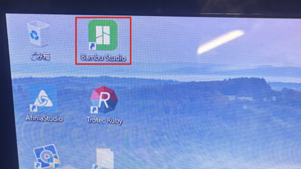

## 手順 2: 準備画面を開く

上部の **準備** タブを押す。

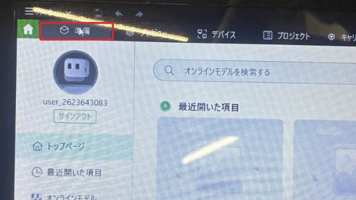

プリンターとプレートが表示された画面になる。

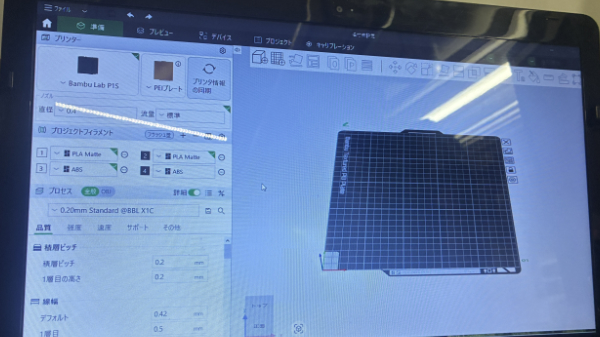

## 手順 3: STL ファイルを読み込む

**箱に + のアイコン** を押し、印刷したい STL ファイルを選ぶ。

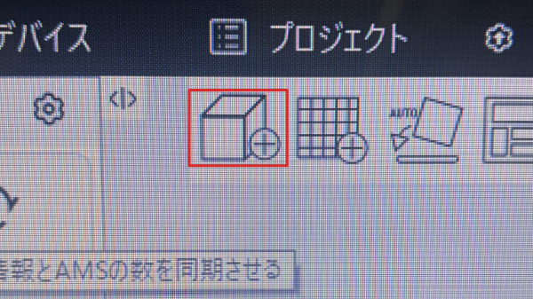

## 手順 4: サポートを有効にする

**サポート** タブで **有効化** にチェックを入れる。宙に浮く部分を支える土台が一緒に印刷される。

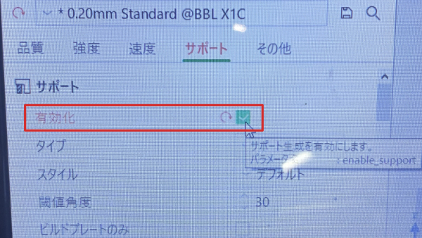

## 手順 5: フィラメントを選ぶ

部品を右クリックし、**フィラメントを変更** から使うフィラメント（例: `1 Bambu PLA Matte`）を選ぶ。

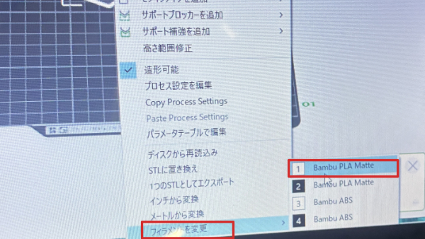

## 手順 6: スライスする

右上の **スライス** を押す。印刷用のデータが作られる。

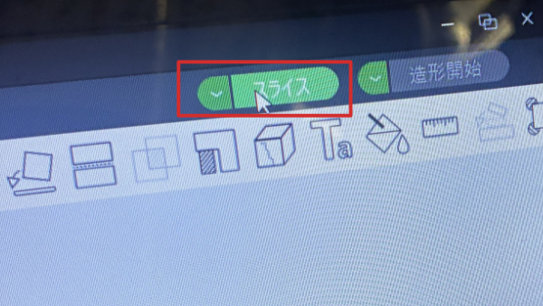

スライス結果に、使うフィラメントの量と印刷時間が表示される。**合計のグラム数は支払いに必要なので記録しておく。**

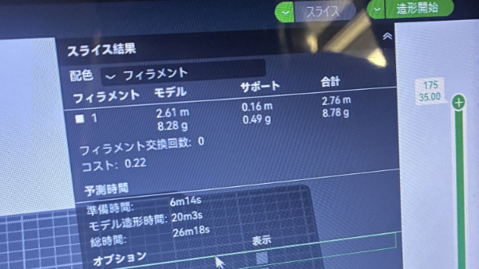

## 手順 7: 印刷を始める

1. 右上の **造形開始** を押す。

   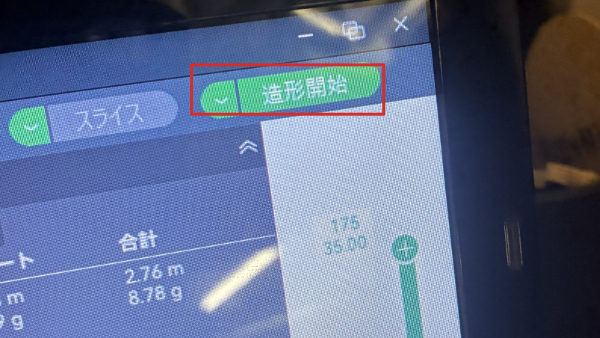

2. **自動ベッドレベリング** を **オン** にする。

   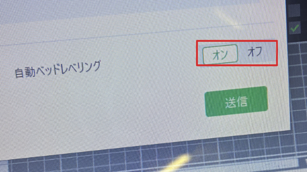

3. **送信** を押すと、印刷が始まる。

   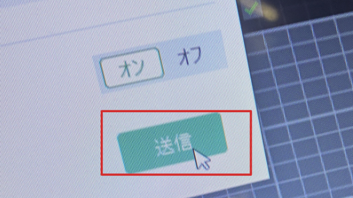

## うまくいかないとき

| 症状 | 対処 |
| --- | --- |
| 部品がベッド（台）にくっつかず、印刷に失敗する | ベッドにマスキングテープを貼る。またはベッドを洗剤で洗い、油汚れを完全に落とす |

## 次へ

[11. 組み立て](./11_assemble.md)
