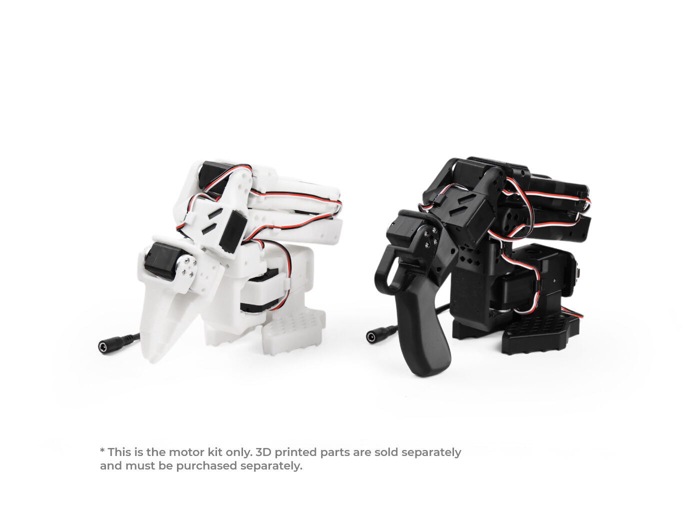
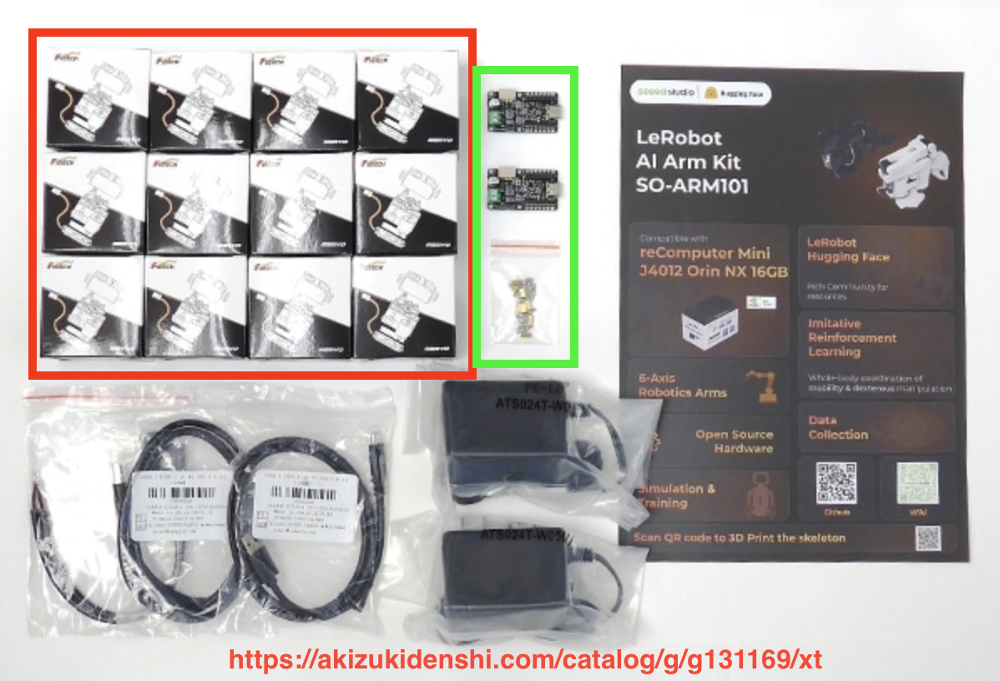
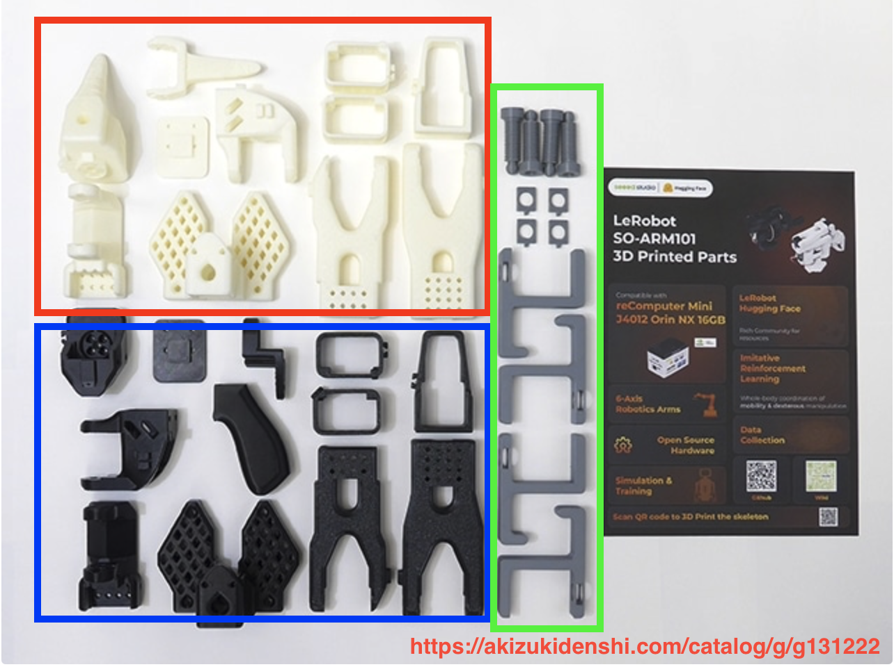
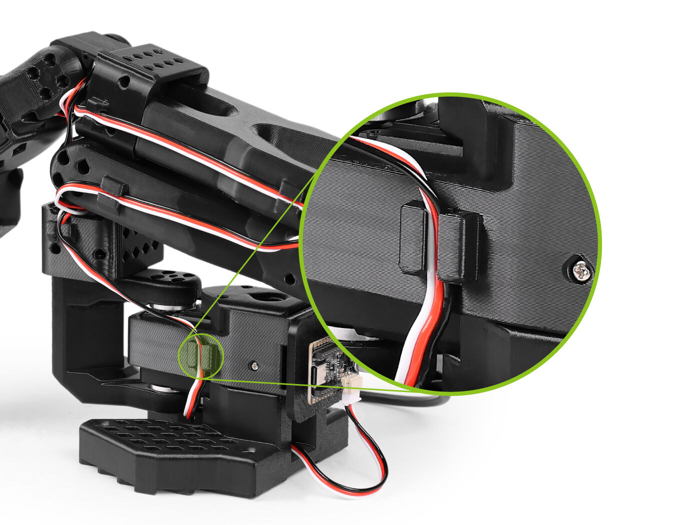
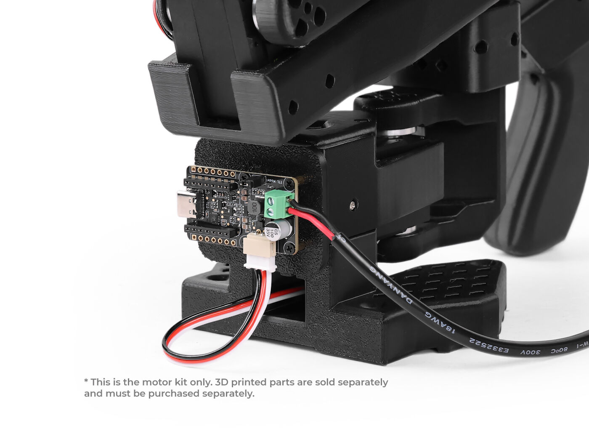
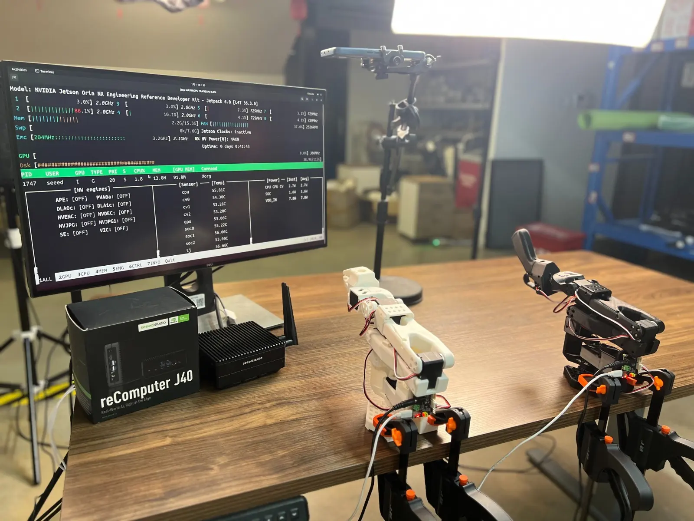

# 11. 組み立て

## 概要

モーターと 3D プリント部品から、SO-101 のフォロワーアームとリーダーアームを組み立てる。初めての場合、組み立てに約 3 時間かかる。

| アーム | 見た目（上の写真） | 役割 |
| --- | --- | --- |
| フォロワー | 白・グリッパー付き（左） | ロボットとして動く側 |
| リーダー | 黒・ハンドル付き（右） | 人が手で動かして操作する側 |

> **フォロワーとリーダーでは使うモーターが違う。** 取り違えやすいので、手順 3 の表を必ず確認する。

## 準備物

**必須**

- [SO-ARM101 モーターキット](https://www.seeedstudio.com/SO-ARM101-Low-Cost-AI-Arm-Kit-p-6426.html)
- 3D プリント部品（[10. 3D プリント](./10_3dprint.md) で印刷したもの、または [購入品](https://www.seeedstudio.com/SO-ARM101-3D-printed-Enclosure-p-6428.html)）
- M2・M3 用のプラスドライバー（磁石付きが便利）
- マイナスドライバー（サポート材の除去に使う）

**次の資料以降で使うもの**

- USB カメラ 2 台
- 正面カメラを固定するスタンド
- クランプ 4 個（付属品は折れやすいので、別に買うとよい）

## 手順 1: 部品をそろえる

### モーターキット

- 赤枠: モーター（STS3215）12 個。ギア比の違う 3 種類がある

  | 型番 | ギア比 | 個数 | 特徴 |
  | --- | --- | ---: | --- |
  | C001 | 1/345 | 7 | 力が強い |
  | C044 | 1/191 | 2 | 普通 |
  | C046 | 1/147 | 3 | 力が弱い（軽く動く） |

- 緑枠: モーターを制御するボード 2 個

型番はモーターのシールで確認できる。

### 3D プリント部品

- 赤枠: フォロワーの部品
- 青枠: リーダーの部品
- 緑枠: アームを机に固定するクランプ

## 手順 2: サポート材を取る

3D プリント部品に付いているサポート材（支えの部分）を、マイナスドライバーなどで取り除く。

## 手順 3: 使うモーターを確認する

関節ごとに、次のモーターを使う。

| 関節 | 番号 | フォロワー（白） | リーダー（黒） |
| --- | :---: | --- | --- |
| Base / Shoulder Pan（根元の回転） | 1 | 1/345（C001） | 1/191（C044） |
| Shoulder Lift（肩） | 2 | 1/345（C001） | 1/345（C001） |
| Elbow Flex（ひじ） | 3 | 1/345（C001） | 1/191（C044） |
| Wrist Flex（手首の曲げ） | 4 | 1/345（C001） | 1/147（C046） |
| Wrist Roll（手首の回転） | 5 | 1/345（C001） | 1/147（C046） |
| Gripper / Handle（グリッパー・ハンドル） | 6 | 1/345（C001） | 1/147（C046） |

> フォロワーはすべて C001。リーダーは関節ごとに違う。

## 手順 4: 関節を組み立てる

公式の動画を見ながら、関節 1 から順に組み立てる。各リンク先で **Follower / Leader** のタブを切り替えられる。

| 関節 | 公式の手順と動画 |
| --- | --- |
| Joint 1 | [Joint 1](https://huggingface.co/docs/lerobot/v0.6.1/so101#joint-1) |
| Joint 2 | [Joint 2](https://huggingface.co/docs/lerobot/v0.6.1/so101#joint-2) |
| Joint 3 | [Joint 3](https://huggingface.co/docs/lerobot/v0.6.1/so101#joint-3) |
| Joint 4 | [Joint 4](https://huggingface.co/docs/lerobot/v0.6.1/so101#joint-4) |
| Joint 5 | [Joint 5](https://huggingface.co/docs/lerobot/v0.6.1/so101#joint-5) |
| Gripper / Handle | [Gripper / Handle](https://huggingface.co/docs/lerobot/v0.6.1/so101#gripper--handle) |

**コツ**

- モーターを部品にはめる前に、3 ピンケーブルを 1 本差しておくと後が楽になる。
- ケーブルは部品の溝に沿わせて通す。

  

> モーターの番号（ID）の設定は [2. SO-101 のセットアップ](./02_setup.md) の手順 3 で行う。公式手順では組み立て前に設定するが、組み立て後でもケーブルをつなぎ替えれば設定できる。

## 手順 5: ボードを取り付ける

1. 電源ケーブルをボードの **緑のコネクタ** に固定する。
2. ボードを四角い 3D プリント部品にねじで固定する。

> **緑のコネクタのプラス・マイナスを逆にすると、ボードが壊れることがある。** ボードの `+` `-` の表示を確認してからつなぐ（通常は赤い線が `+`）。

## 手順 6: 机に固定する

クランプでアームの土台を机に固定する。

## 次へ

[1. LeRobot のインストール](./01_install.md)

## 参考

- [LeRobot 公式: SO-101](https://huggingface.co/docs/lerobot/v0.6.1/so101)
- [TheRobotStudio/SO-ARM100](https://github.com/TheRobotStudio/SO-ARM100)
- [Seeed Studio: Bus Servo Driver Board](https://wiki.seeedstudio.com/bus_servo_driver_board/)
